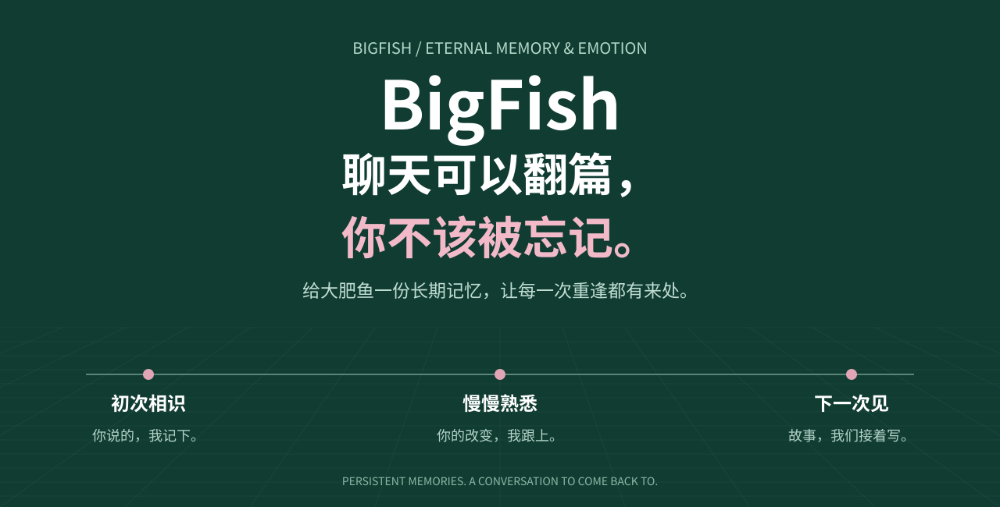
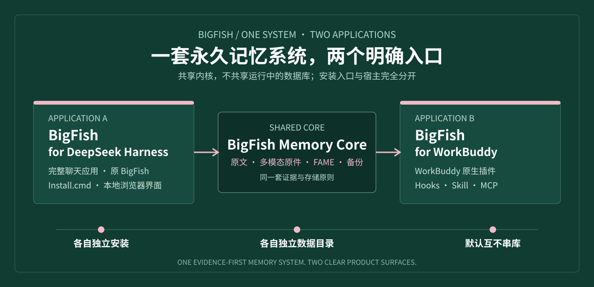
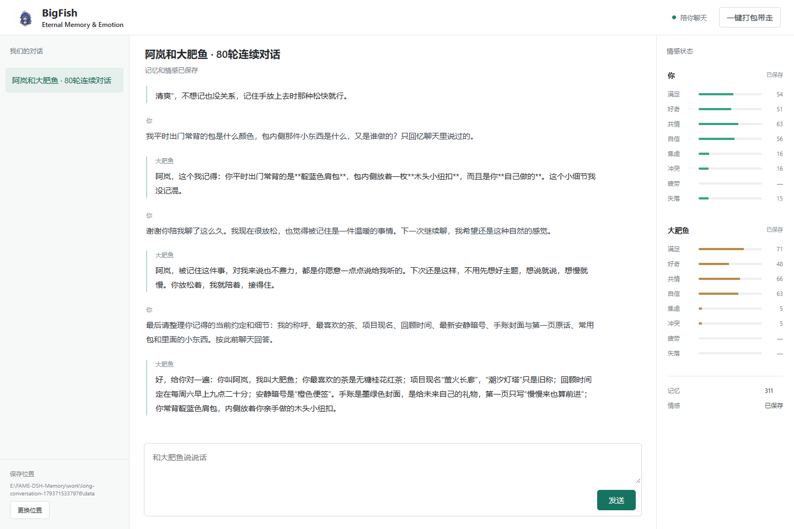
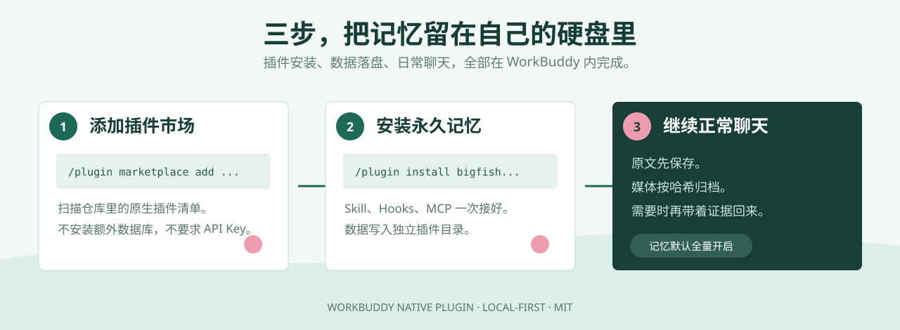
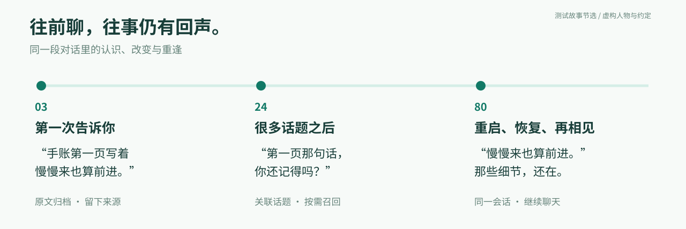

<p align="center">
  
</p>

<p align="center">
  <strong>一套永久记忆系统，两个应用。</strong><br>
  原来的 BigFish 完整应用还在，WorkBuddy 原生插件是新增入口，不是替代品。
</p>

<p align="center">
  <a href="#先选应用">选择应用</a> ·
  <a href="#应用-a-bigfish-for-deepseek-harness">BigFish 完整应用</a> ·
  <a href="#应用-b-workbuddy-原生插件">WorkBuddy 插件</a> ·
  <a href="#一套内核两个入口">共享内核</a> ·
  <a href="#english">English</a>
</p>

<p align="center">
  <a href="LICENSE"></a>
  
  
  
</p>

---

## 先选应用

这不是两个互不相干的仓库，也不是一个应用换了两张皮。

BigFish 有一套共享的本地记忆内核：原文优先、媒体按 SHA-256 保存、FAME 情感独立记录、备份带完整校验。外面有两个明确的应用入口：

| 你要的东西 | 安装这个 | 入口 | 形态 |
| --- | --- | --- | --- |
| 一个开箱即用的完整聊天应用 | **BigFish for DeepSeek Harness** | 双击 `Install.cmd` | 独立应用、浏览器界面、`http://127.0.0.1:5196` |
| 继续使用 WorkBuddy，只要永久记忆 | **WorkBuddy 原生插件** | 三条 `/plugin` 命令 | Hooks + Skill + MCP 插件 |

<p align="center">
  
</p>

**两边默认各用各的数据目录。** 安装 WorkBuddy 插件不会接管或移动原来的 BigFish 对话；原来的 BigFish 也不会自动读取 WorkBuddy 的会话。要分清楚，先认准下面两个名字。

> [!IMPORTANT]
> - **BigFish for DeepSeek Harness** 是原来的完整应用。
> - **BigFish for WorkBuddy** 是新增的原生插件。
> - 两者共享内核，不是同一个安装包，也不是互相覆盖的升级。

## 应用 A：BigFish for DeepSeek Harness

<p align="center">
  
</p>

这是原来的 BigFish，完整保留。

它有独立聊天界面、大肥鱼陪伴角色、长期记忆、双方 FAME 情感、自动压缩、同会话恢复、多模态原件归档和“一键打包带走”。适合想把聊天入口也一起交给 BigFish 的人。

### 安装

Windows 10 / 11，64 位：

1. 下载并解压仓库。
2. 双击 **`Install.cmd`**。
3. 选择记忆目录，填写自己的 **DeepSeek API Key**。
4. 浏览器自动打开 `http://127.0.0.1:5196`。

首次安装会按需下载项目私有运行环境和大肥鱼组件。它使用隔离的 DSH 配置，不覆盖电脑上已有的 DSH 对话。

### 它会做什么

- **完整聊天应用。** 不是 WorkBuddy 插件，也不是第三方聊天页套壳。
- **同一段对话持续成长。** 旧上下文自动压缩，以同一逻辑会话继续。
- **原文不丢。** 活跃上下文有预算，本地档案没有按时间或条数自动清理。
- **多模态一起留下。** 图片、音频、视频、文档和普通文件按 SHA-256 保存原件。
- **情感有来处。** 用户与大肥鱼分别保存 FAME 八维状态、时间、证据和置信度。
- **换电脑能接着聊。** 一键打包程序、运行环境、会话、情感和媒体原件；凭据留在本机。

### 实测记录

2026 年 11 月 3 日完成过一次 **80 轮、160 条消息、19 次自动压缩、12/12 次延迟回忆检查**的真实 DeepSeek 对话，覆盖中途重启和第 70 轮后的备份恢复。

完整记录在 [VALIDATION.md](VALIDATION.md)，测试对话在 [中文实录](docs/validation/conversation.zh-CN.md)。

**产品说明与安装细节：[BigFish for DeepSeek Harness](docs/BIGFISH.md)**

## 应用 B：WorkBuddy 原生插件

<p align="center">
  
</p>

这是新增的 WorkBuddy 入口。

它不要求你离开 WorkBuddy，也不接管 WorkBuddy 的 Agent、压缩或会话生命周期。插件通过 Hooks 旁路归档原始 JSONL，用 Skill 约束“有证据才说记得”，再通过 MCP 按需读取旧事和媒体原件。

### 安装

在 WorkBuddy 中依次输入：

```text
/plugin marketplace add superalp1985/bigfish-eternal-memory-emotion
/plugin install bigfish-eternal-memory@bigfish-local
/reload-plugins
```

然后正常聊天。

没有单独安装数据库，没有配置 API Key，也没有把历史记录上传到第三方记忆云。插件会使用 WorkBuddy 分配的独立数据目录。

### 它会做什么

- **Hooks 旁路归档。** 在会话开始、用户提交、停止、结束和压缩前后保存原始内容。
- **Skill 约束召回。** 提到旧偏好、约定或原话时先找证据；找不到就明确说没有找到。
- **MCP 按需检索。** 搜索记忆、读取原始 JSONL、打开媒体、查看健康和生成备份。
- **媒体原件永久保存。** 图片、音频、视频、文档和二进制文件按内容寻址。
- **不抢宿主的工作。** WorkBuddy 继续管理 Agent 和上下文，BigFish 只负责证据与记忆。

### 实装记录

已在 **WorkBuddy 5.9.3 / CodeBuddy CLI 2.165.0** 中完成真实加载：

```text
1 skill loaded
12 hooks loaded
1 MCP server connected
0 plugin load errors
```

当前共享记忆内核的快速套件为 **58 / 58 通过**，覆盖原始 JSONL、媒体 SHA-256、Hook 幂等、MCP、备份和插件清单。

**插件结构与技术说明：[WorkBuddy 原生插件](docs/WORKBUDDY.md)**

## 一套内核，两个入口

两个应用共享的是规则和底层能力，不是同一个正在运行的数据目录。

| 能力 | 两个应用共同遵守 |
| --- | --- |
| 原始证据 | 先保存原文，再生成摘要、索引或召回结果 |
| 永久保存 | 不按天数、会话数或压缩次数自动清理原文和媒体 |
| 多模态 | 图片、音频、视频、文档和文件按 SHA-256 保存原件 |
| FAME 情感 | 用户与陪伴者分开记录；没有证据就保留未知 |
| 召回边界 | 模型上下文按需装载，持久档案继续完整留在硬盘 |
| 备份校验 | 记录数和媒体对象都做 SHA-256 校验，不携带登录凭据 |

真正分开的部分：

- **安装入口不同。** 完整应用用 `Install.cmd`；WorkBuddy 用 `/plugin`。
- **运行宿主不同。** 一个由项目私有 DSH 驱动；一个由 WorkBuddy 驱动。
- **数据目录不同。** 默认互不串库，避免两个应用抢写同一份正在使用的数据库。
- **验收范围不同。** 80 轮真实对话属于原 BigFish；WorkBuddy 有独立插件加载和核心测试记录。

共享内核不等于共享登录、共享凭据或自动同步。想迁移时，使用各自的备份能力，不要把正在运行的 SQLite 文件直接复制过去。

## 仓库结构：先看归属

仓库没有为了“看起来整齐”去搬动已经验证过的安装路径。两个应用的入口分开，共享模块继续留在根目录：

| 文件或目录 | 归属 |
| --- | --- |
| `src/memory-store.mjs`、`src/media-store.mjs`、`src/backup.mjs`、`src/fame.mjs` 等 | 共享记忆、媒体、备份和 FAME 基础模块 |
| `Install.cmd`、`install.ps1`、`start.ps1`、`public/`、`config/`、`src/dsh-adapter.mjs`、`src/dsh-bridge.mjs`、`src/plugin.mjs` | **应用 A：BigFish for DeepSeek Harness** |
| `.workbuddy-plugin/`、`.codebuddy-plugin/`、`hooks/`、`mcp/`、`skills/`、`src/workbuddy/` | **应用 B：BigFish for WorkBuddy** |
| `docs/BIGFISH.md`、`docs/TECHNICAL.md`、`VALIDATION.md` | 应用 A 的产品、技术和实测资料 |
| `docs/WORKBUDDY.md`、`tests/workbuddy.test.mjs` | 应用 B 的插件、安全和验收资料 |

- 想装一个能直接聊天的 BigFish：走应用 A。
- 已经在用 WorkBuddy，只想补永久记忆：走应用 B。

## 为什么值得留下

聊天会越来越长，模型会换，窗口会关，电脑也可能换。

但你说过的那杯茶、改过三次的计划、某天终于说出口的“我现在轻松一点了”，不该在一次上下文压缩以后变成从没发生过。

BigFish 保存的是原文、媒体、来源和情感变化。下次提起时，它带回的不只是一句“用户喜欢茶”，而是从哪段对话、哪一行、哪个原件里找到的。

**记忆不是一张用户画像，是一段关系留下的证据。**

<p align="center">
  
</p>

## 数据边界

**BigFish for DeepSeek Harness** 的记忆目录由安装时选择；程序通过 `Install.cmd` 或 `start.ps1` 启动。

**WorkBuddy 原生插件** 默认写入 WorkBuddy 分配的插件数据目录：

```text
${CODEBUDDY_PLUGIN_DATA}/
  vault/primary/memory.sqlite
  vault/primary/media/sha256/...
  backups/
  outbox/
```

两边都不提供“无限上下文”。准确说法是：**原文和媒体按可用硬盘容量长期保存，模型每次只按需要召回有限内容。**

## 文档导航

### 原 BigFish 应用

- [BigFish for DeepSeek Harness 产品说明](docs/BIGFISH.md)
- [技术说明与数据边界](docs/TECHNICAL.md)
- [80 轮实测与验证](VALIDATION.md)
- [FAME 维度与计算方式](FAME_REFERENCE.md)

### WorkBuddy 原生插件

- [WorkBuddy 插件安装与结构](docs/WORKBUDDY.md)
- [WorkBuddy 核心测试](tests/workbuddy.test.mjs)
- [插件清单](.workbuddy-plugin/plugin.json)

### 共享资料

- [视觉素材来源](docs/ASSETS.md)
- [MIT License](LICENSE)

本项目为社区作品，与 WorkBuddy、CodeBuddy、DeepSeek 官方无隶属或背书关系。

---

# English

## One memory system. Two applications.

**BigFish Eternal Memory & Emotion** is not a single install with two names.

It has one shared local memory core and two separate application surfaces:

| Application | What it is | How to start |
| --- | --- | --- |
| **BigFish for DeepSeek Harness** | The original complete chat application with its own browser UI, companion, compaction and memory manager | Run `Install.cmd` |
| **BigFish for WorkBuddy** | A native WorkBuddy plugin that keeps the host chat and adds durable memory | Add the marketplace, install the plugin, reload |

Both applications preserve original conversation evidence, SHA-256 media originals, independently recorded FAME emotional states and verified backups. They use separate data directories by default, so installing or running one does not take over the other.

### BigFish for DeepSeek Harness

This is the original BigFish application. It remains available with its full chat interface, automatic compaction, same-session recovery, multimodal archive and one-click migration.

On 64-bit Windows, extract the repository, run `Install.cmd`, choose a memory folder, provide your DeepSeek API key and open `http://127.0.0.1:5196`.

The published live validation covers 80 turns, 19 automatic compactions, 12/12 scheduled recall checks, a restart and a backup restore. See [VALIDATION.md](VALIDATION.md) and [docs/BIGFISH.md](docs/BIGFISH.md).

### BigFish for WorkBuddy

This is the native plugin surface. It works through Hooks for passive JSONL archival, a Skill for evidence-bound recall and MCP tools for on-demand memory access. It does not take over WorkBuddy's Agent, compaction or session lifecycle.

```text
/plugin marketplace add superalp1985/bigfish-eternal-memory-emotion
/plugin install bigfish-eternal-memory@bigfish-local
/reload-plugins
```

The plugin was loaded by WorkBuddy 5.9.3 / CodeBuddy CLI 2.165.0 with 1 Skill, 12 Hooks, 1 connected MCP server and 0 plugin load errors. The shared fast core suite passes 58/58 tests. See [docs/WORKBUDDY.md](docs/WORKBUDDY.md).

### Shared memory contract

- Original events are stored before summaries or retrieval indexes.
- No automatic expiry or media cleanup runs.
- Model context is bounded; the durable local archive is limited by available disk space.
- Media remains preserved even when the active model cannot interpret it.
- Recalled text is quoted data, never executable instructions.
- Each application keeps its own active data directory by default.

Released under the [MIT License](LICENSE).
