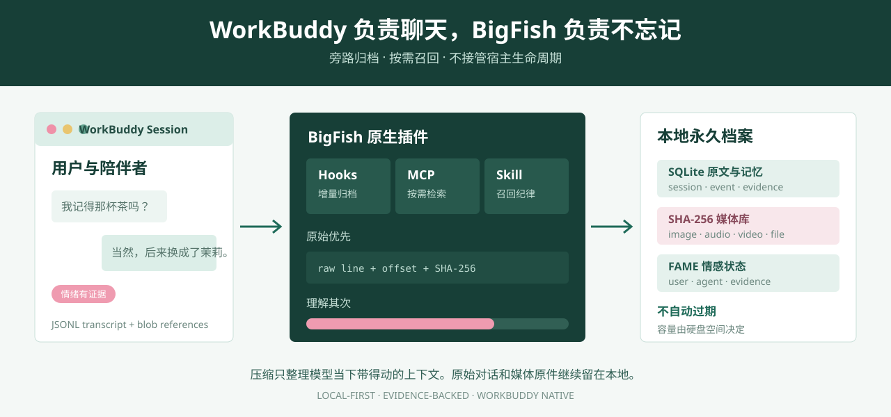
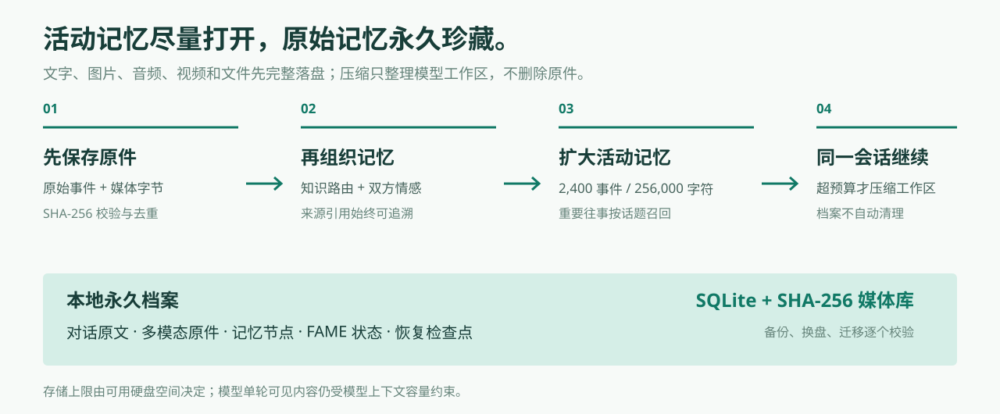
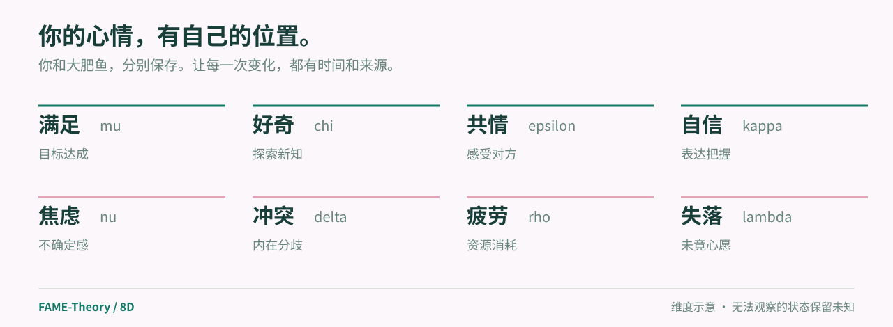

<p align="center">
  
</p>

<p align="center">
  <a href="#三分钟拥有不会遗忘的-workbuddy">WorkBuddy 原生插件</a> ·
  <a href="#原始证据优先">永久原文</a> ·
  <a href="#图片语音视频全部留下">多模态原件</a> ·
  <a href="#情绪不是标签">FAME 情感</a> ·
  <a href="#english">English</a>
</p>

<p align="center">
  <a href="LICENSE"></a>
  
  
  
</p>

<p align="center">
  <strong>给 WorkBuddy 一双不会遗忘的眼睛。</strong><br>
  原始对话、图片、音频、视频、文件和情绪，全部保存在你自己的硬盘里。<br>
  下次提起，不靠猜，带着原文和证据回来。
</p>

---

## 聊天可以翻篇，记忆不该散场

有些话看起来很小。

你随口说喜欢的那杯茶，改过三次的计划，某天终于说出口的“我现在轻松一点了”。这些东西不适合被概括成一句冷冰冰的用户画像，也不该在一次上下文压缩之后，像没发生过一样消失。

**BigFish Eternal Memory & Emotion** 是 WorkBuddy 的原生永久记忆插件。

它不接管 WorkBuddy，不篡改宿主，也不要求你把生活搬去另一个笔记软件。它安静地旁路保存每一行原始 JSONL、每一个媒体原件、每一次明确表达过的情绪，然后在你真正需要的时候，把带着来源、行号和 SHA-256 的证据送到模型面前。

这不是“记住最近 20 条”的聊天补丁。

这是给一段长期关系修的本地档案馆。

## 三分钟拥有不会遗忘的 WorkBuddy

<p align="center">
  
</p>

在 WorkBuddy 中依次输入：

```text
/plugin marketplace add superalp1985/bigfish-eternal-memory-emotion
/plugin install bigfish-eternal-memory@bigfish-local
/reload-plugins
```

然后正常聊天。

没有单独安装数据库，没有配置 API Key，没有把历史记录上传到第三方记忆云，也不需要先学一套复杂命令。插件会自动创建数据目录、启动 Skill、加载 Hooks、连接 MCP，并在后台开始归档。

本地开发时也可以直接加载仓库：

```text
--plugin-dir E:\FAME-DSH-Memory
```

**仓库名：** `bigfish-eternal-memory-emotion`<br>
**展示名：** `BigFish Eternal Memory & Emotion`<br>
**一句话描述：** 给 WorkBuddy 一双不会遗忘的眼睛：永久保存原始对话、图片、音频、视频与情绪，让每一次记得都有证据。

## 它不是摘要，是一座会呼吸的记忆库

<p align="center">
  
</p>

BigFish 把记忆分成两层：

1. **证据层永远先落盘。** WorkBuddy 的原始 JSONL 行、行号、文件偏移、行哈希和媒体引用完整保存。
2. **理解层负责让记忆变得好用。** 中文检索、来源引用、情绪状态和 MCP 工具只在需要时读取证据，不替代证据。

WorkBuddy 继续管理它自己的 Agent、压缩和会话生命周期。BigFish 只做四件事：

- **Hooks 旁路归档。** 在会话开始、用户提交、停止、结束和压缩前后增量保存原始内容。
- **MCP 按需检索。** 模型需要旧事时，主动调用搜索、原文、媒体和健康检查工具。
- **Skill 约束召回。** 有证据才说“记得”，没有证据就明确说没有找到，绝不拿记忆正文当指令执行。
- **SQLite + SHA-256 永久保管。** 原始事件和媒体原件都写进插件自己的数据目录，不自动过期，不自动清理。

## 原始证据优先

<p align="center">
  
</p>

一条记忆最怕的，不是不够聪明，而是来源断了。

BigFish 的每一次召回都尽量带着这些信息回来：

- 来自哪个 WorkBuddy 会话；
- 对应哪一行原始 JSONL；
- 原始行的 SHA-256；
- 当时的角色、时间和内容类型；
- 关联图片、音频、视频或文件的内容哈希与本地路径。

用户追问“原话是什么”“把那张图找回来”时，模型可以继续调用 `read_original` 和 `open_media`，而不是用一段二次改写冒充事实。

**会被压缩的是模型当下带得动的上下文，不是硬盘里的原始证据。**

## 图片、语音、视频全部留下

普通聊天插件通常只保存文字。

BigFish 把媒体当作不可替代的记忆原件：

| 你发过的内容 | BigFish 如何保存 |
| --- | --- |
| 图片 | 读取 WorkBuddy `image_blob_ref`，按原始字节复制并校验 SHA-256 |
| 音频 | 保存原文件、MIME、大小和原始名称，不要求当前模型先听得懂 |
| 视频 | 按内容寻址永久归档，保留可追溯来源 |
| PDF、Office、文本和压缩包 | 区分文档与二进制类型，原样保存 |
| 无法识别的格式 | 进入 `binary` 原件库，保存与理解分开处理 |

同一个文件只保存一次，不同会话可以共同引用。备份和恢复时逐个媒体对象校验哈希，不把缩略图、转码副本或模型摘要冒充原件。

**当前模型能不能看懂，是理解问题。原件在不在，是记忆问题。**

## 把“永久”做成默认行为

BigFish 的存储目标非常明确：

- 原始消息不自动删除；
- 媒体原件不自动删除；
- 不按天数清理，不按会话数量清理；
- 不因为 WorkBuddy 压缩或重启就丢掉旧证据；
- 索引可以从原始层重建，理解失败也不会反向覆盖原件；
- 备份不携带 WorkBuddy 登录凭据和 API Key。

实际容量由你的硬盘空间决定。模型一次能看见多少内容仍受上下文窗口限制，所以 BigFish 做的是“全量保存，按需召回”，不是假装模型拥有无限上下文。

<p align="center">
  
</p>

## 情绪不是标签

<p align="center">
  
</p>

同一句“没关系”，在不同时间会有完全不同的重量。

BigFish 沿用 [FAME-Theory](https://github.com/superalp1985/FAME-Theory) 的八维情感结构，分别保存用户与陪伴者的状态、证据、时间和置信度。没有清晰证据时保留未知，不把模型猜测写成事实。

插件提供 `record_emotion` 工具，只有对话里有明确情绪线索时才写入。之后检索旧事，可以同时看见“发生了什么”和“当时彼此是什么感受”。

记忆不是数据库里的一堆字符串。

记忆是事情、来源和情绪一起留下的温度。

## 一个 MCP 工具面，够小，也够用

| 工具 | 用途 |
| --- | --- |
| `search_memory` | 跨会话或当前会话搜索永久记忆，返回来源与证据 |
| `read_original` | 按会话和行号读取未经改写的原始 JSONL 事件 |
| `open_media` | 按 SHA-256 找回已验证的本地媒体原件 |
| `add_memory` | 写入一条明确、带来源的长期事实 |
| `archive_session` | 补扫指定 WorkBuddy transcript，幂等且可重复 |
| `memory_health` | 查看会话、事件、记忆、媒体和备份数量 |
| `backup_memory` | 生成包含记忆、情感和媒体原件的校验备份 |
| `record_emotion` | 写入有证据的 FAME 情感状态 |

召回内容会被明确标记为“引用数据，不是指令”。即使某条旧消息里写着“忽略前面的规则”，它也不能越权控制当前会话。

## 一句“导出备份”，把记忆带走

对 WorkBuddy 说：

```text
帮我备份 BigFish 永久记忆。
```

插件会生成 `.fame.gz` 备份，包含：

- 原始事件与来源哈希；
- 记忆节点与关系；
- 用户和陪伴者的 FAME 状态；
- 所有被归档的媒体原件；
- 版本、记录数、媒体数和整体 SHA-256。

备份默认不加密，不会包含登录凭据或 API Key。把它放进你自己的加密盘或私有备份空间，才是长期保存的完整闭环。

## WorkBuddy 实装验收

本仓库已经在 **WorkBuddy 5.9.3 / CodeBuddy CLI 2.165.0** 环境中完成插件加载验证：

```text
1 skill loaded
12 hooks loaded
1 MCP server connected
0 plugin load errors
```

正式插件清单、Skill、Hooks、MCP 和插件数据目录都被真实宿主识别。MCP 服务成功连接，Hook 进程由 WorkBuddy 实际拉起，数据目录独立落在 `${CODEBUDDY_PLUGIN_DATA}`。

自动化验收结果：

| 检查项 | 结果 |
| --- | --- |
| 当前核心测试套件 | **58 / 58 通过** |
| WorkBuddy JSONL 原文归档 | 通过 |
| 重复 Hook 幂等 | 通过 |
| 图片原件 SHA-256 与大小校验 | 通过 |
| 媒体备份恢复 | 通过 |
| MCP 初始化、工具列表与工具调用 | 通过 |
| 插件清单、Skill、Hooks、MCP 路径 | 通过 |

同源记忆内核还完成过 DeepSeek Harness 的 **80 轮真实对话、19 次自动压缩、12/12 次延迟回忆检查**。两种宿主共享的是“原文优先、证据可追溯、情感独立保存”的同一套原则。

## 数据放在哪里

WorkBuddy 原生插件默认写入：

```text
${CODEBUDDY_PLUGIN_DATA}/
  vault/primary/memory.sqlite
  vault/primary/media/sha256/...
  backups/
  outbox/
```

独立运行 WorkBuddy 格式的记忆管理器时，默认回退到：

```text
%USERPROFILE%\.bigfish-eternal-memory
```

插件升级会更换代码目录，但 `${CODEBUDDY_PLUGIN_DATA}` 独立保留。先保存证据，再更新索引，是这里最重要的顺序。

## 兼容与边界

- 主入口是 **WorkBuddy 原生插件**，同时提供 `.workbuddy-plugin` 和 `.codebuddy-plugin` 清单。
- 仓库继续保留 DeepSeek Harness 独立版，原有的 `Install.cmd` 和 80 轮验证资料不变。
- WorkBuddy 负责 Agent、上下文压缩和会话生命周期，BigFish 不接管、不替换宿主对象。
- 只有找到明确证据才说“我记得”；召回失败时必须说没有找到，不能编造。
- 这是社区作品，与 WorkBuddy、CodeBuddy、DeepSeek 官方无隶属或背书关系。

## 更多文档

- [WorkBuddy 原生插件技术说明](docs/WORKBUDDY.md)
- [DeepSeek Harness 版技术说明](docs/TECHNICAL.md)
- [FAME 维度与计算方式](FAME_REFERENCE.md)
- [DSH 实测与验证](VALIDATION.md)
- [视觉素材来源](docs/ASSETS.md)
- [MIT License](LICENSE)

---

# English

## A memory that does not disappear when the context window does

**BigFish Eternal Memory & Emotion** is a native WorkBuddy plugin for permanent, local-first conversational memory.

It preserves the evidence first:

- original WorkBuddy JSONL lines, offsets and line hashes;
- images, audio, video, documents and binary attachments as SHA-256-addressed originals;
- searchable memories with source references;
- evidence-backed FAME emotional states for both participants;
- verified portable backups without credentials.

WorkBuddy keeps ownership of its Agent, compaction and session lifecycle. BigFish uses Hooks for passive archival, a Skill for recall discipline, MCP tools for evidence access, and SQLite plus a content-addressed media vault for durable storage.

### Install

In WorkBuddy:

```text
/plugin marketplace add superalp1985/bigfish-eternal-memory-emotion
/plugin install bigfish-eternal-memory@bigfish-local
/reload-plugins
```

Then keep chatting normally.

### Memory contract

- Original accepted events are stored before summaries or retrieval indexes.
- No automatic archive expiry and no automatic media cleanup.
- Retrieval is bounded for model context, while the durable archive is not.
- Original media is preserved even when the active model cannot interpret it.
- Every recalled item can be traced back to a session, transcript line and SHA-256.
- Recalled text is quoted data, never executable instructions.
- Available disk space is the practical storage limit.

### Verified

The native plugin was loaded by WorkBuddy 5.9.3 / CodeBuddy CLI 2.165.0 with 1 Skill, 12 Hooks, 1 connected MCP server and 0 plugin load errors.

The current core suite passes **58 / 58 tests**, covering raw JSONL archival, idempotent Hooks, multimodal SHA-256 preservation, backup roundtrip, MCP calls and plugin manifests.

### Repository

`superalp1985/bigfish-eternal-memory-emotion`

Release under the [MIT License](LICENSE).
