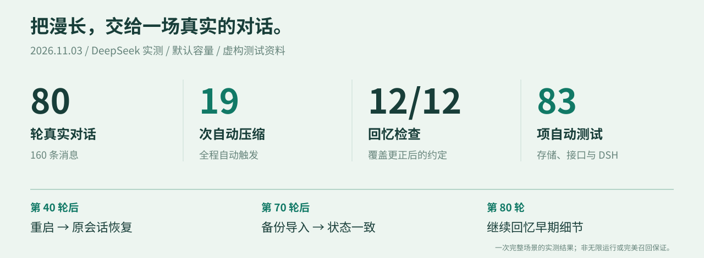
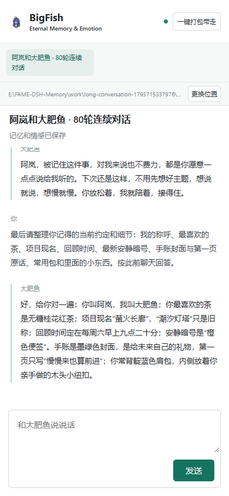
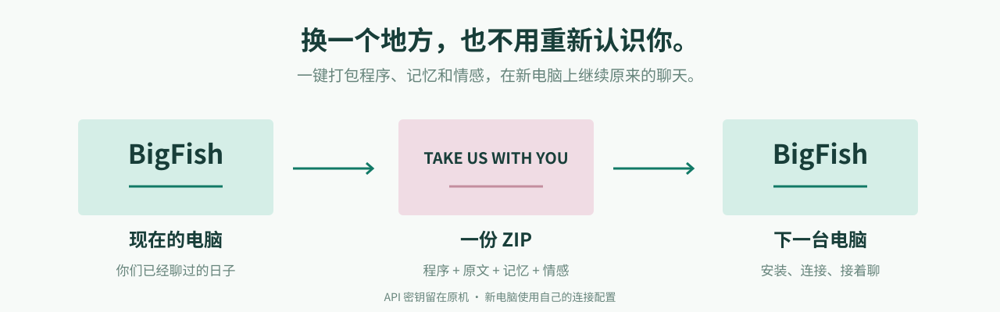

  

  <strong>给大肥鱼一份可以带走的记忆，给漫长的聊天一个不必重新认识的明天。</strong> 
  DeepSeek Harness · 长期记忆 · 双方 FAME 情感 · 自动压缩 · 同一会话 · 一键迁移

  <a href="#开始我们的下一句话">开始使用</a> ·
  <a href="#80-轮之后它记得什么">真实实测</a> ·
  <a href="#记忆应该跟着你走">备份迁移</a> ·
  <a href="#english">English</a>

---

## 你说过的那些小事，值得被认真记住

你随口说喜欢的一杯茶，改了好几次的计划，只有你们知道的暗号。还有那天，你终于说出“我现在很放松”。

**BigFish Eternal Memory & Emotion** 想把这些留住。

让聊天越来越长，让熟悉慢慢累积。旧对话归档，重要的事留下线索；下次提起，循着线索再想起。你可以改主意、换电脑，也可以明天再来。

> “隔了这么多话题，你还记得我们约好的回顾时间、最早的安静暗号，以及手账第一页写的那句话吗？不要猜。”
>
> **“手账第一页写的是‘慢慢来也算前进’。”**
>
> 第 24 轮真实模型测试节选。人物、约定和测试内容均为虚构。

  

## 把“我记得”做成一件有凭有据的事

  

**这一屏里，有一路聊过来的细节。** 茶换了口味，项目改了名字，时间重新约过。第 80 轮提问没有重新给出答案，大肥鱼回忆了更新后的约定，也找回了早期手账上的原话。

| 你想留下的 | BigFish 为它做的事 |
| --- | --- |
| 随口提过的喜好、称呼和小秘密 | 自动提取记忆，关联原始对话，按当前话题召回 |
| 聊天时的情绪变化 | 分别保存你和大肥鱼的 FAME 八维情感状态 |
| 很长很长的同一段聊天 | 自动压缩旧上下文，以同一 session ID 重建精简工作区 |
| 图片、语音、视频和其他文件 | 原始字节按 SHA-256 永久归档，和消息一起备份、迁移、恢复 |
| 那些不必每轮都带着的往事 | 原文留在本机硬盘，旧活动对象释放，需要时再检索 |
| 换盘、换电脑后的“我们” | 打包程序、记忆、约定和情感，在新位置恢复后接着聊 |

## 记忆有来处，情绪有延续

  

同一句“没关系”，在不同的时刻，会有不同的分量。

这里的情感维度来自 [FAME-Theory](https://github.com/superalp1985/FAME-Theory)。双方各自拥有状态、时间和来源记录；没有足够信息的维度保留未知，让变化有迹可循。

记忆组织借鉴 [FAME Knowledge Agent Gateway](https://github.com/superalp1985/fame-knowledge-agent-gateway) 的路由、节点与来源引用结构，形成每个会话自己的知识层。它留在你的本地记忆库里。

## 聊天往前走，往事有地方安放

  

先保存原文，再整理记忆；先验证新的工作快照，再释放旧活动对象。整个过程通过 DSH 插件和公开生命周期接口完成，**不修改 Agent 核心源码**。

默认工作区预算已扩展到 **2,400 条事件 / 256,000 字符**，近期内容预算 **64,000 字符**，最多同时加载 **8 个会话**。近期内容优先留在工作区，完整历史、媒体原件和双方情感永久留在本机档案中；没有自动过期、自动删图或按时间清理。重启时读取检查点和当前活动代次，继续同一个会话。

聊天框可以直接添加图片、音频、视频和普通文件。在所选模型与提供方支持时，图片会通过 DeepSeek Harness 的原生视觉附件进入模型请求；其他文件由 DSH 以只读文件句柄呈现。无论模型是否能理解某种格式，BigFish 都先保存原件，保存与理解互不混淆。

## 80 轮之后，它记得什么？

  

2026 年 11 月 3 日，使用正式默认容量，完成一场 **80 轮、160 条消息**的真实 DeepSeek 对话。途中更改偏好、调整约定、重启进程、导出并恢复备份，然后接着聊。

| 实测项目 | 记录 |
| --- | --- |
| 延迟回忆与约定更新 | **12 / 12** 个预设检查通过 |
| 自动压缩 | **19 次**，未手动触发 |
| 压缩后的工作区 | **14,179–20,977 字符** |
| 第 40 轮后重启 | 同一会话恢复，双方情感和工作快照一致 |
| 第 70 轮后备份恢复 | 导入后状态一致，继续完成余下 10 轮 |
| 情感保存 | **160 条**双方状态记录 |
| 回收后 JS 堆采样 | **88.08–90.16 MiB**，两段进程合计 8 个采样点 |
| 自动测试 | **53 项存储与接口 + 30 项 DSH 集成**通过 |

[阅读完整测试对话](docs/validation/conversation.zh-CN.md) · [查看验证说明](VALIDATION.md) · [查看逐轮指标](docs/validation/metrics.json)

这些数字来自本次实测，不是无限时长、零延迟或百分百召回的保证。下一次聊天有下一次的故事，我们选择把过程也记录下来。

## 开始我们的下一句话

**Windows 10 / 11，64 位。** 把程序放到你喜欢的盘，建议使用空间充足的 D 盘或 E 盘。

1. 点击仓库上方 **Code → Download ZIP**，解压到固定文件夹。
2. 双击 **`Install.cmd`**。首次安装会按需下载运行环境和大肥鱼组件。
3. 选择记忆保存位置，填写自己的 **DeepSeek API Key**。浏览器打开后，就可以开始聊天。

安装后会配置自动启动；日常只需要打开聊天页面。默认本机地址为 `http://127.0.0.1:5196`，端口被占用时会自动选择其他可用端口。程序、缓存和记忆优先保存在安装目录或你选择的目录中。

  

同一页面的小屏布局实测。图片展示响应式界面，不表示提供原生手机 App。

## 记忆应该跟着你走

  

**换文件夹、换硬盘：** 点「更换位置」。程序自动打包、校验并切换记忆位置，原有数据保留。

**换电脑：** 点「一键打包带走」。得到包含程序、运行环境、全部记忆、双方情感和多模态原件的 ZIP；在新电脑解压，运行 `Install.cmd`，配置自己的模型连接，继续原来的会话。

带走的是原文、记忆、约定、情感和图片/音频/视频/文件原件。媒体按内容去重，备份和恢复逐个校验 SHA-256；API 密钥留在本机，不进入迁移包。

> 愿下一次打开窗口时，你不用从“你好，我叫……”重新开始。

## 想了解更多

- [技术说明与数据边界](docs/TECHNICAL.md)
- [FAME 维度与计算方式](FAME_REFERENCE.md)
- [实测与验证](VALIDATION.md)
- [视觉素材来源](docs/ASSETS.md)

当前运行时固定为项目私有的 DeepSeek Harness `0.2.2-alpha.3`，不会覆盖电脑上已有的 DSH 安装和对话。对话及模型可理解的附件会发送给你配置的模型服务，记忆提取和压缩也会产生模型调用；本地备份为压缩包，不提供加密。该项目为社区作品，与 DeepSeek 官方无隶属或背书关系。

---

## English

### A conversation worth coming back to

**BigFish Eternal Memory & Emotion** adds persistent conversation memories and emotional continuity to BigFish on DeepSeek Harness.

The little things matter: a favorite tea, a changed plan, a private phrase. BigFish archives the original conversation, organizes memories with source references, and retrieves relevant details when the topic returns.

- **Keep the same session.** Older context is compacted, checkpointed and replaced through public DSH lifecycle APIs.
- **Keep the original words.** SQLite preserves the archive while the active working set and recall cache remain bounded.
- **Keep the original media.** Images, audio, video and files are stored byte-for-byte in a SHA-256-addressed archive and included in backup and migration.
- **Keep both sides of the story.** Separate eight-dimensional FAME states are saved for the user and companion.
- **Take the memories with you.** One-click packaging includes the app, runtime, memories and emotional records. Credentials stay on the original machine.

The completed live run covered **80 turns**, **19 automatic compactions**, **12/12 scheduled recall checks**, a process restart and a backup restore. The automated suites passed **83 tests**. These are measured results for this scenario, not a guarantee of unlimited runtime or perfect recall.

**Install:** on 64-bit Windows, download and extract the repository ZIP, then run `Install.cmd`. The installer downloads missing runtime components, asks for a storage folder and your DeepSeek API key, and opens the chat. Keep the installation folder in a permanent location.

**Move:** use the storage-location control, or package the app and memories into a ZIP, extract it on the destination computer and run `Install.cmd`.

The active window defaults to 2,400 events / 256,000 characters, while the durable archive has no automatic expiry or media cleanup. Image understanding uses the Harness attachment route when the selected model and provider support it; other media remains durably downloadable even when the model cannot interpret it. Model calls use the configured remote service. Backups are compressed, not encrypted. This is an independent community project.

[Technical notes](docs/TECHNICAL.md) · [FAME reference](FAME_REFERENCE.md) · [Validation](VALIDATION.md) · [Visual credits](docs/ASSETS.md)
