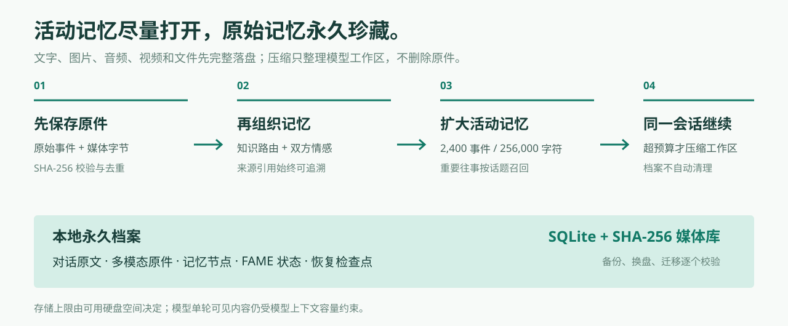
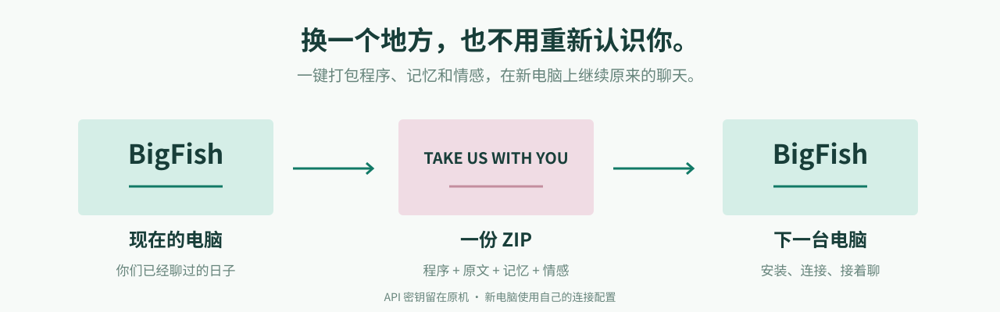

# BigFish for DeepSeek Harness

这是原来的 BigFish 完整应用。

它不是 WorkBuddy 插件，也不是本仓库里的第二个启动器。它由项目私有的 DeepSeek Harness `0.2.2-alpha.3` 和 `dsh-dafeiyu@0.1.23` 驱动，提供独立聊天界面、永久记忆、双方 FAME 情感、自动压缩、同会话恢复和多模态原件归档。

> 想使用 WorkBuddy？请回到 [WorkBuddy 原生插件](WORKBUDDY.md)。两个应用共享记忆内核，但安装入口和数据目录分开。

## 适合谁

- 想要一个直接可用的完整聊天应用；
- 希望旧上下文自动压缩后，仍在同一逻辑会话继续；
- 需要聊天界面、大肥鱼陪伴角色和双方情感状态；
- 需要把程序、记忆、情感和媒体一起打包迁移；
- 不想接管或修改日常使用的 DSH 对话。

## 安装

环境：Windows 10 / 11，64 位。

1. 下载并解压仓库到固定目录。
2. 双击 **`Install.cmd`**。
3. 选择记忆保存位置。
4. 填写自己的 **DeepSeek API Key**。
5. 浏览器打开 `http://127.0.0.1:5196`。

首次安装会下载并校验 Node 运行环境，安装项目私有 DSH 和大肥鱼组件。端口被占用时会自动选择其他可用端口。

安装器使用隔离的运行目录，不覆盖电脑上已有的 DSH 安装和对话。程序、缓存和记忆优先保存在安装目录或用户选择的记忆目录中。

## 你会得到什么

### 同一段对话继续

旧上下文达到预算后自动压缩。BigFish 先保存原文、检查点和双方工作状态，再通过 DSH 公开生命周期接口创建下一代工作区。它不修改 Agent 核心源码，也不会把压缩摘要当成完整历史。

默认工作区预算：

- 2,400 条事件；
- 256,000 字符；
- 近期内容 64,000 字符；
- 最多同时加载 8 个会话。

工作区有边界，本地档案没有按时间、会话数或压缩次数自动清理。

### 原文与多模态原件

聊天框可以发送图片、音频、视频、文档和普通文件。

- 原始消息保存在 SQLite；
- 媒体按 SHA-256 内容寻址保存；
- 图片在模型支持时通过 DSH 原生视觉附件进入请求；
- 其他格式即使当前模型不能理解，原件也不会因此丢失；
- 保存与理解分开处理，不用摘要或缩略图冒充原件。

  

### 双方 FAME 情感

用户与大肥鱼分别保存八维 FAME 状态、时间、证据和置信度。没有足够信息时保留未知，不把模型猜测写成确定事实。

同一句“没关系”在不同时间会有不同重量。情感记录让检索旧事时，除了看见发生了什么，也能看见当时彼此的状态。

### 备份与迁移

**换文件夹、换硬盘：** 使用页面中的「更换位置」，程序会打包、校验并切换记忆目录，旧数据保留。

**换电脑：** 使用「一键打包带走」，得到包含程序、运行环境、全部记忆、双方情感和媒体原件的 ZIP。在新电脑解压后运行 `Install.cmd`，继续原来的会话。

API Key、DSH 登录信息和机器配置不会进入迁移包。压缩包默认不加密，应放在自己的加密盘或私有备份位置。

  

## 实测记录

2026 年 11 月 3 日，使用当时正式默认容量完成一场真实 DeepSeek 对话：

| 项目 | 结果 |
| --- | --- |
| 对话量 | 80 轮、160 条消息 |
| 自动压缩 | 19 次 |
| 延迟回忆与约定更新 | 12 / 12 通过 |
| 第 40 轮后重启 | 同会话、双方情感和工作快照恢复 |
| 第 70 轮后备份恢复 | 状态一致，继续完成余下 10 轮 |
| 原文核对 | 160 条逐条匹配，无丢轮和重复消息 |

这些结果覆盖的是该次长对话、重启和恢复场景，不代表无限时长、零延迟或百分百召回保证。

完整记录：

- [实测说明](../VALIDATION.md)
- [完整中文对话](validation/conversation.zh-CN.md)
- [逐轮指标](validation/metrics.json)
- [桌面截图](assets/conversation-desktop.png)
- [小屏截图](assets/conversation-mobile.png)

## 数据与边界

- 记忆目录在安装时由用户选择；
- SQLite 是插件自己的长期档案；
- 不要只复制正在使用的 `.sqlite` 文件，应使用页面备份；
- 模型调用、记忆提取和压缩可能使用远程模型服务；
- 活跃上下文始终有上限，“永久”指本地档案，不是无限模型窗口；
- 本应用与 DeepSeek 官方无隶属或背书关系。

## 更多文档

- [技术说明与数据边界](TECHNICAL.md)
- [FAME 维度与计算方式](../FAME_REFERENCE.md)
- [实现边界](../IMPLEMENTATION.md)
- [视觉素材来源](ASSETS.md)
- [WorkBuddy 原生插件](WORKBUDDY.md)

---

## English

### BigFish for DeepSeek Harness

This is the original complete BigFish application, powered by a project-private DeepSeek Harness runtime and the `dsh-dafeiyu` companion.

On 64-bit Windows, extract the repository, run `Install.cmd`, choose a memory directory, provide your DeepSeek API key and open `http://127.0.0.1:5196`.

It provides a complete browser chat UI, automatic context compaction with same-session recovery, independently stored FAME states for both participants, SHA-256 media originals, and one-click migration of the application, runtime, memories, emotions and media.

The active working set is bounded. The durable local archive has no automatic age- or session-count-based cleanup and is limited by available disk space. This application is separate from the WorkBuddy native plugin; they share memory principles and core code, but use separate installation and data paths by default.

The published live validation covers 80 turns, 19 automatic compactions, 12/12 recall checks, a planned restart and a backup restore. See [VALIDATION.md](../VALIDATION.md).
